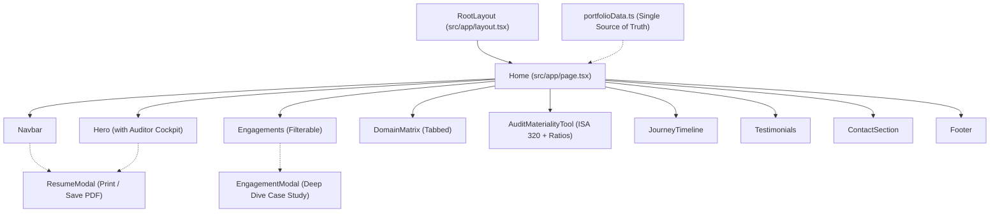

# CharterStride Technical Architecture

## 1. System Overview

**CharterStride** is a modern, high-performance portfolio application tailored for Junior Chartered Accountants, CA Finalists, and Articled Audit Trainees. It is engineered with Next.js 16 (App Router), React 19, TypeScript, Tailwind CSS v4, and Framer Motion.

The design philosophy balances **corporate executive gravitas** with **fluid modern web interactivity**:
- Dark slate/charcoal foundations (`#080c14`, `#0f172a`) evoke executive stability.
- Subtle gold/amber (`#f59e0b`, `#d97706`) and emerald accents highlight audit precision and assurance.
- Zero clutter: all configuration is centralized in a typed single source of truth (`src/data/portfolioData.ts`).

---

## 2. Directory Structure

```
charter-stride/
├── docs/                          # Exhaustive project documentation
│   ├── ARCHITECTURE.md            # Technical and component architecture
│   ├── AUDIT_FORMULAS.md          # ISA 320 & ratio calculation formulas
│   ├── CUSTOMIZATION_GUIDE.md     # Step-by-step personalization guide
│   └── DEPLOYMENT.md              # Vercel, Netlify & static export guide
├── public/                        # Static assets (favicons, icons)
├── src/
│   ├── app/                       # Next.js App Router root
│   │   ├── globals.css            # Tailwind v4 directives & glassmorphic utilities
│   │   ├── layout.tsx             # Root layout, fonts, and SEO metadata
│   │   └── page.tsx               # Primary page assembling components
│   ├── components/                # Modular client components
│   │   ├── Navbar.tsx             # Sticky responsive navigation & mobile menu
│   │   ├── Hero.tsx               # Hero header, live metrics & assurance card
│   │   ├── Engagements.tsx        # Filterable practical fieldwork showcase
│   │   ├── EngagementModal.tsx    # In-depth case study modal dialog
│   │   ├── DomainMatrix.tsx       # Tabbed skills & standards competency matrix
│   │   ├── AuditMaterialityTool.tsx # Interactive ISA 320 & ratio workbench
│   │   ├── JourneyTimeline.tsx    # Chronological progression & certifications
│   │   ├── Testimonials.tsx       # Partner & client endorsements
│   │   ├── ContactSection.tsx     # Direct inquiry form & email copy utility
│   │   ├── Footer.tsx             # Ethics disclaimer & quick jump navigation
│   │   └── ResumeModal.tsx        # Browser executive CV with print-to-PDF
│   └── data/
│       └── portfolioData.ts       # Typed single source of truth for all content
├── next.config.ts                 # Next.js configuration
├── package.json                   # Dependencies and npm scripts
├── tsconfig.json                  # TypeScript compiler settings
└── README.md                      # Project manual and overview
```

---

## 3. Technology Stack & Rationale

| Layer | Technology | Version | Purpose / Rationale |
| :--- | :--- | :--- | :--- |
| **Framework** | Next.js | 16.4.x | App Router, static page prerendering (SSG), Turbopack compilation. |
| **Runtime UI** | React | 19.3.x | Component model and modern hooks. |
| **Language** | TypeScript | 5.x | Strict type safety across all metrics, engagements, and parameters. |
| **Styling** | Tailwind CSS | 4.x | Utility-first CSS using `@import "tailwindcss";` and custom glass layers. |
| **Motion** | Framer Motion | 12.x | Physics-based animations, layout transitions, and modal animators. |
| **Iconography** | Lucide React | 1.x | Lightweight SVG iconography tailored for financial and UI indicators. |

---

## 4. Component Hierarchy & Data Flow



---

## 5. State Management & Interactivity

The application avoids complex external state containers (like Redux or Zustand) in favor of localized React hooks:
1. **Modal Visibility**: Managed via `useState<boolean>` in `Home` and `Engagements`.
2. **Category Filtering**: Animated item switching handled seamlessly by Framer Motion's `layout` and `<AnimatePresence>`.
3. **Interactive Mini-Tools**: State-driven sliders and radio selectors recompute values synchronously in pure memory with zero latency.
4. **Clipboard State**: Timed feedback indicator with 2.5-second reset for direct email copying.

---

## 6. Performance & Build Profile

- **Rendering Mode**: 100% Statically Generated (`○ (Static)`) at build time.
- **Client Bundle**: Code-split automatically per route and component.
- **Zero Server Runtime Required**: Capable of running on standard Node servers or being deployed as a static site (`output: 'export'`) to AWS S3, Cloudflare Pages, or GitHub Pages.
